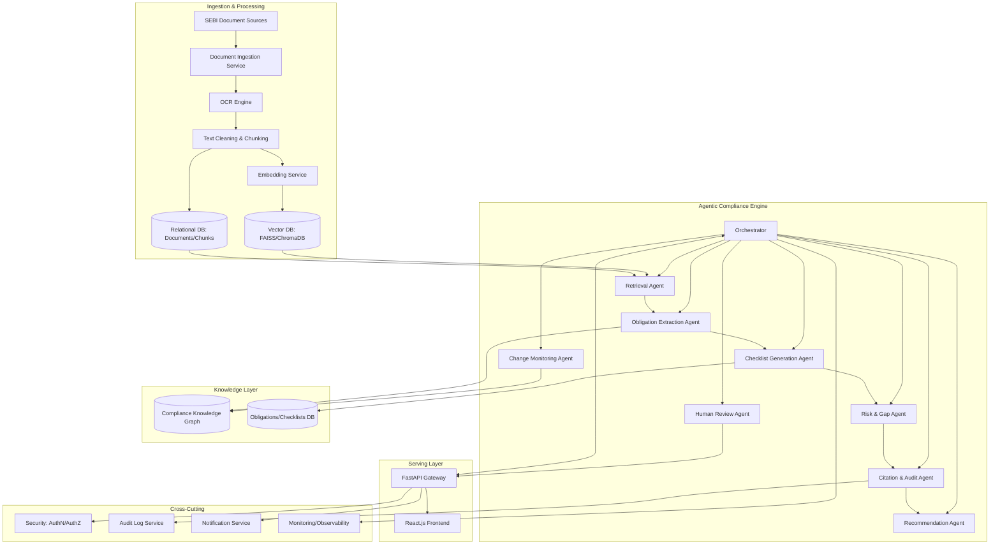
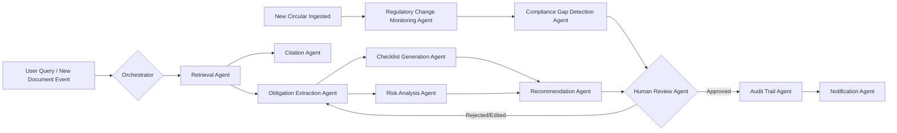
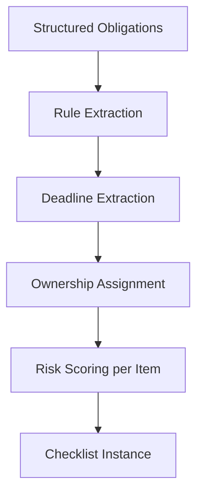
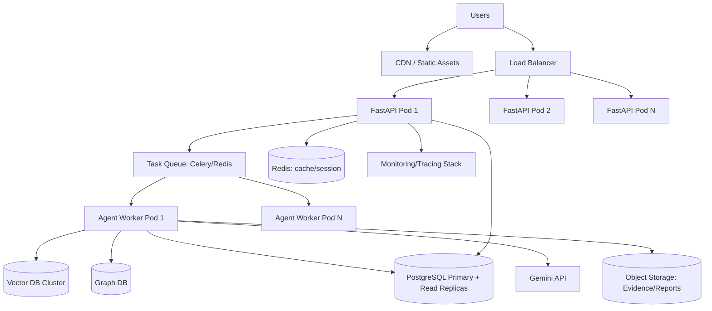

# Agentic Compliance OS
## From Regulatory Text to Operational Action
### Enterprise PRD · SRS · TDD · System Blueprint

**Source concept:** SEBI Securities Market TechSprint — PS-2, Team Tax Evaders
**Document type:** Implementation-ready specification (Product + Engineering + Architecture)
**Status:** v1.0 — reverse-engineered and expanded from concept deck

---

## Table of Contents

1. Executive Summary
2. Product Vision
3. User Personas
4. Product Requirements Document (PRD)
5. System Architecture
6. Agentic Architecture Design
7. Regulatory Intelligence Pipeline
8. Compliance Knowledge Graph
9. Database Design
10. API Specification
11. UI/UX Specification
12. Compliance Checklist Engine
13. Risk Engine
14. Audit Trail System
15. Security Architecture
16. AI/LLM Architecture
17. Deployment Architecture
18. Scalability Plan
19. Future Scope Expansion
20. Implementation Roadmap
21. Engineering Task Breakdown
22. Final CTO Review

---

# 1. Executive Summary

## 1.1 The Problem

SEBI (Securities and Exchange Board of India) publishes a continuous, high-velocity stream of circulars, master circulars, notifications, and amendments that govern how brokers, depositories, mutual funds, listed companies, and other market intermediaries operate. Today this regulatory text lives as **unstructured PDF documents** — often hundreds of pages long, written in dense legal language, revised piecemeal by later amendments, and distributed with no machine-readable obligation layer.

The consequence is a fully manual compliance workflow:

- Compliance officers read, re-read, and manually tag circulars.
- Obligations, deadlines, and ownership are extracted by hand into spreadsheets.
- Cross-referencing an amendment against the base circular is done by human memory or search.
- Audit evidence is scattered across email threads, shared drives, and static trackers.
- There is no continuous signal when a new circular silently changes an existing obligation.

This creates three concrete failure modes: **missed deadlines** (penalty and enforcement risk), **inconsistent interpretation** (different teams read the same clause differently), and **audit fragility** (no single source of truth proving what was known, when, and what was done about it).

## 1.2 Existing Pain Points (expanded from source problem statement)

| Pain Point | Operational Impact |
|---|---|
| Lengthy regulatory documents (100+ pages) | High cost-per-question; SMEs spend hours locating a single clause |
| Unstructured PDF format | No structured obligation extraction possible without manual tagging |
| Frequent regulatory updates | Continuous monitoring burden; amendment drift goes undetected |
| Complex legal language | Misinterpretation risk; requires legal/compliance expertise to parse |
| Manual compliance process | Non-scalable; breaks down as entity count and regulation count grow |
| No structured obligation ledger | Impossible to build dashboards, SLAs, or automated reminders |
| No machine-verifiable citation trail | Regulatory answers cannot be defended in an audit or SEBI inspection |

## 1.3 Target Users

Market intermediaries regulated by SEBI and the internal teams that keep them compliant: stock brokers, depository participants, mutual fund AMCs, listed companies, RTAs, and the compliance/risk/audit functions inside each. See Section 3 for full personas.

## 1.4 Business Value

- **Time compression**: natural-language regulatory search and summarization collapse hours of manual document review into minutes (target ≥70% reduction, per source deck's stated impact goal).
- **Cost avoidance**: fewer missed obligations translates directly into avoided SEBI penalties, show-cause notices, and reputational damage.
- **Scalable compliance operations**: a single compliance officer can cover a materially larger regulatory surface area when obligations are pre-extracted and checklist-ready.
- **Defensible audit posture**: citation-backed, immutable audit trails turn "we believe we were compliant" into "here is the evidence."

## 1.5 Regulatory Value

- Improves overall market integrity by raising the compliance floor across intermediaries, particularly smaller entities that cannot afford large in-house legal teams.
- Creates a feedback loop SEBI itself could eventually consume (aggregate, anonymized compliance-gap analytics) to identify where regulatory language is commonly misread — informing clearer future drafting.
- Reduces systemic risk by shortening the lag between a circular's publication and its operational implementation across the market.

## 1.6 Why This Matters Now

Agentic AI systems have crossed the reliability threshold needed for **retrieval-grounded, citation-verified** outputs in regulated domains. The opportunity is not a chatbot — it is to compress the entire chain from **regulatory text → structured obligation → operational task → audit evidence** into one continuously-running system. This document specifies that system as an **Agentic Compliance Operating System**, not a point tool.

---

# 2. Product Vision

## 2.1 Mission

Convert every SEBI regulatory publication into structured, actionable, auditable compliance logic within minutes of release — and keep every downstream compliance task synchronized with the regulatory source of truth for its entire lifecycle.

## 2.2 Long-Term Vision

A single **Agentic Compliance OS** that:

1. Ingests regulatory text from any Indian or international regulator (SEBI first, then RBI, IRDAI, PFRDA, MCA, GST, and beyond — see Section 19).
2. Maintains a living **Compliance Knowledge Graph** connecting circulars, clauses, obligations, entities, deadlines, and penalties.
3. Runs a **multi-agent system** that autonomously extracts obligations, generates checklists, scores risk, detects compliance gaps, and drafts operational recommendations.
4. Keeps a human-in-the-loop review layer for anything above a confidence/risk threshold, while allowing low-risk, high-confidence actions to execute autonomously.
5. Produces citation-backed, audit-grade evidence for every action it takes or recommends.

## 2.3 North Star Metric

**Time-to-Compliance-Readiness (TTCR)**: the elapsed time from a new circular's publication to a fully generated, assigned, and trackable compliance checklist inside the platform, with citations verified. Target: < 30 minutes for standard circulars (non-scanned, digitally native PDFs).

## 2.4 Success Metrics

| Category | Metric | Target (Year 1) |
|---|---|---|
| Retrieval quality | Citation-backed answer accuracy | ≥ 95% (matches source deck's stated benchmark) |
| Speed | Reduction in manual document lookup time | ≥ 70% |
| Coverage | % of new circulars auto-processed within 24h | ≥ 98% |
| Trust | % of AI answers requiring human correction | < 5% |
| Adoption | Weekly active compliance officers / licensed seats | ≥ 60% |
| Checklist accuracy | % of auto-generated checklist items accepted without edit | ≥ 80% |

## 2.5 Business KPIs

- Net Revenue Retention (NRR) ≥ 110% by end of Year 2 (enterprise compliance tooling benchmark).
- Logo retention ≥ 90% annually.
- Expansion revenue from multi-regulator modules ≥ 25% of ARR by Year 3.

## 2.6 Compliance KPIs

- Zero missed regulatory deadlines tracked inside the platform that were not explicitly flagged in advance.
- 100% of AI-generated answers carry a verifiable citation (document, section, page).
- Mean time-to-detect a regulatory change affecting an existing obligation < 4 hours from publication.

---

# 3. User Personas

Each persona includes goals, pain points, day-in-the-life workflow, and platform permission tier.

### 3.1 Compliance Officer (Primary persona — "Arjun Mehta" in source screenshots)
- **Goals**: Stay ahead of every applicable SEBI obligation; generate audit-ready evidence; minimize personal liability.
- **Pain points**: Reads circulars line-by-line; maintains manual trackers; fears missing a silent amendment.
- **Workflow**: Morning regulatory digest review → query platform on ambiguous clauses → assign checklist items to team → track completion → export audit report before inspections.
- **Permissions**: Full read/write on obligations, checklists, tasks within their organization; can approve AI-generated recommendations; cannot modify audit logs (immutable).

### 3.2 Risk Analyst
- **Goals**: Quantify and rank compliance risk exposure across business lines.
- **Pain points**: No systematic way to score regulatory risk; relies on qualitative judgment.
- **Workflow**: Reviews Risk Dashboard → drills into risk findings → runs scenario/what-if analysis → escalates high-risk items.
- **Permissions**: Read on all obligations/circulars; write on RiskFindings and risk scoring parameters; no access to task assignment.

### 3.3 Internal Auditor
- **Goals**: Independently verify that compliance activities occurred and are evidenced.
- **Pain points**: Evidence scattered across systems; no immutable trail; time-consuming manual sampling.
- **Workflow**: Selects a circular or period → pulls full audit trail → cross-checks task completion evidence → produces audit report.
- **Permissions**: Read-only on everything, including audit logs and agent execution logs; export rights on reports.

### 3.4 Brokerage Operations Manager
- **Goals**: Translate compliance obligations into day-to-day operational SOPs for front-line staff.
- **Pain points**: Obligations arrive as legal text, not operational instructions.
- **Workflow**: Receives assigned checklist items → converts into team SOPs → marks completion with evidence attachments.
- **Permissions**: Read on assigned obligations/checklists; write on ComplianceTasks status and evidence upload.

### 3.5 SEBI Regulatory Team (external-facing / future B2G persona)
- **Goals**: Understand market-wide compliance posture and common points of misinterpretation.
- **Pain points**: No aggregate visibility into how intermediaries interpret circulars.
- **Workflow**: (Future scope) Views anonymized, aggregated compliance-gap analytics dashboards.
- **Permissions**: Read-only, aggregated/anonymized data only; no entity-level access.

### 3.6 Mutual Fund Compliance Team
- **Goals**: Track AMC-specific obligations (NAV disclosure, KYC, risk-o-meter disclosures, etc.).
- **Pain points**: Mutual fund regulations are dense and cross-reference multiple master circulars.
- **Workflow**: Filters platform by "Mutual Fund" entity type → reviews AMC-specific checklist → tracks investor-facing disclosure deadlines.
- **Permissions**: Same tier as Compliance Officer, scoped to Mutual Fund regulation category.

### 3.7 Depository Participant (DP)
- **Goals**: Ensure demat account operations (KYC, transmission, pledge) meet SEBI/Depositories Act requirements.
- **Pain points**: DP-specific circulars are frequently amended; hard to track version lineage.
- **Workflow**: Monitors DP-tagged circular feed → checks version history of relevant clauses → updates internal SOPs.
- **Permissions**: Compliance Officer tier, scoped to DP category.

### 3.8 Stock Broker
- **Goals**: Meet KYC, margin, risk disclosure, and reporting obligations without a large compliance department.
- **Pain points**: Small brokers often lack dedicated legal counsel; highest exposure to interpretation error.
- **Workflow**: Uses chat interface for plain-language Q&A → relies heavily on auto-generated checklists (as shown in source screenshots' "Stock Broker Registration" checklist).
- **Permissions**: Standard user tier — checklist consumption, chat Q&A, task completion; no admin rights.

---

# 4. Product Requirements Document (PRD)

For each core module: Problem, User Need, Functional Requirements (FR), Non-Functional Requirements (NFR), Acceptance Criteria (AC).

## 4.1 Module: Document Ingestion & OCR

**Problem**: Regulatory PDFs arrive in mixed formats — digitally native, scanned, image-embedded tables.
**User Need**: Any SEBI document, regardless of format, must become clean structured text without manual pre-processing.

- FR-1: System shall accept PDF upload via UI, bulk upload (zip), and automated crawl from SEBI's public circular repository.
- FR-2: System shall detect scanned vs. digital PDFs and route scanned documents through OCR.
- FR-3: System shall preserve document structure (headings, clause numbers, tables, footnotes) during extraction.
- FR-4: System shall deduplicate documents by content hash to avoid reprocessing.
- NFR-1: OCR processing shall complete within 3 minutes for a 100-page document (p95).
- NFR-2: OCR accuracy shall exceed 98% character-level accuracy on standard SEBI circular formatting.
- AC-1: Given a scanned 50-page circular, when uploaded, then extracted text preserves clause numbering with ≥98% fidelity and the document is queryable within 5 minutes.

## 4.2 Module: Semantic Search / RAG Q&A

**Problem**: Keyword search fails on legal language where the same obligation is phrased differently across documents.
**User Need**: Ask a plain-language question and get an accurate, citation-backed answer.

- FR-5: System shall accept natural-language queries and return answers grounded only in retrieved SEBI document chunks.
- FR-6: Every answer shall include inline citations (document name, section/regulation number, page number).
- FR-7: System shall support follow-up/conversational queries with retained context.
- FR-8: System shall display a confidence score with every answer (as shown in source screenshots — e.g., "96%").
- NFR-3: p95 query response latency < 6 seconds end-to-end.
- NFR-4: Answers shall not hallucinate obligations not present in retrieved source chunks (target: 0 unverifiable claims in QA sampling).
- AC-2: Given the query "What are the KYC requirements for stock brokers?", when submitted, then the system returns a structured summary, a compliance checklist, applicable entities, and verified source citations matching the source screenshot's Query Response pattern.

## 4.3 Module: Obligation Extraction

**Problem**: Legal text does not map 1:1 to discrete, assignable obligations.
**User Need**: Every "shall / must / is required to" clause should become a structured, trackable obligation.

- FR-9: System shall extract obligation statements with: obligated party, obligation text, deadline (if any), penalty (if referenced), source clause citation.
- FR-10: System shall classify obligations by type (disclosure, reporting, record-keeping, KYC, risk management, governance).
- FR-11: System shall flag obligations with ambiguous deadlines for human review.
- NFR-5: Obligation extraction precision ≥ 90%, recall ≥ 85% against a hand-labeled validation set.
- AC-3: Given a circular containing 20 "shall" clauses, when processed, then the system extracts ≥17 correctly-attributed obligations with citations.

## 4.4 Module: Compliance Checklist Generation

**Problem**: Obligations are not operational tasks until sequenced, assigned, and given a status model.
**User Need**: One-click conversion of a circular into a trackable checklist (as shown in source screenshot's "Compliance Checklist Generator", 6/6 completed example).

- FR-12: System shall auto-generate a checklist per obligation set, per entity type (e.g., "Stock Broker Registration").
- FR-13: Checklist items shall support status states: Not Started, In Progress, Completed, Overdue, Not Applicable.
- FR-14: System shall allow manual edit/override of any auto-generated checklist item.
- FR-15: System shall support checklist export (PDF/DOCX/Excel), matching source screenshot's "Download PDF / Export Report / Audit Trail" actions.
- AC-4: Given a new master circular affecting Stock Broker Registration, when the checklist is generated, then each item links back to its source obligation and citation.

## 4.5 Module: Risk & Gap Analysis

**Problem**: Not all obligations carry equal risk; teams need prioritization, not just a flat list.
**User Need**: Understand which gaps are highest risk and why.

- FR-16: System shall score each obligation/gap on likelihood × impact.
- FR-17: System shall highlight missing compliance requirements relative to an entity's current documented state.
- NFR-6: Risk scores shall be explainable (factor breakdown available on demand), not a black-box number.
- AC-5: Given an entity with an incomplete KYC process, when risk analysis runs, then the missing step is surfaced with a risk score and remediation recommendation.

## 4.6 Module: Audit Trail & Reporting

**Problem**: Compliance actions must be provable after the fact, including to SEBI inspectors.
**User Need**: Immutable, exportable record of every action, decision, and piece of evidence.

- FR-18: Every state change (obligation status, checklist item, AI-generated answer) shall be logged immutably with actor, timestamp, and source.
- FR-19: System shall generate exportable audit reports scoped by date range, entity, or circular.
- NFR-7: Audit logs shall be tamper-evident (cryptographic hash chaining or WORM storage).
- AC-6: Given an auditor requests evidence for a specific obligation, when exported, then the report includes the full lifecycle: source citation → extraction → checklist → task completion → evidence attachment.

## 4.7 Module: Regulatory Change Monitoring

**Problem**: Amendments silently change existing obligations; teams don't know what changed.
**User Need**: Be notified when a new circular affects something already tracked.

- FR-20: System shall diff new circulars against the knowledge graph to detect affected existing obligations.
- FR-21: System shall send notifications (in-app, email) when an affected obligation is detected.
- AC-7: Given a new circular amends a clause referenced by an existing tracked obligation, when ingested, then affected users are notified within 4 hours with a before/after diff.

---

# 5. System Architecture

## 5.1 Layer Overview

| Layer | Responsibility |
|---|---|
| Frontend | React.js SPA — dashboards, chat, checklist, audit views |
| Backend / API Gateway | FastAPI — auth, routing, orchestration entrypoint |
| Agent Layer | Multi-agent orchestration (LangGraph-style state machine) |
| LLM Layer | Gemini (primary) + swappable model abstraction |
| Vector Layer | FAISS / ChromaDB — embedding storage & similarity search |
| Knowledge Layer | Compliance Knowledge Graph (graph DB) + relational metadata store |
| Compliance Layer | Obligation/Checklist/Task domain services |
| Audit Layer | Immutable event log, evidence store |
| Security Layer | AuthN/AuthZ, encryption, secrets management |
| Monitoring Layer | Metrics, tracing, alerting |
| Analytics Layer | BI/reporting warehouse |
| Notification Layer | Email, in-app, (future) voice/SMS |

## 5.2 High-Level Architecture Diagram

## 5.3 Layer Detail Notes

- **Frontend**: React.js SPA consuming REST APIs; state managed via React Query for server cache; role-based UI rendering.
- **Backend**: FastAPI chosen for async I/O (needed for concurrent LLM/tool calls), auto-generated OpenAPI docs, and Python-native integration with the AI stack.
- **Agent Layer**: Stateful orchestrator (see Section 6) coordinating specialized agents; each agent is a bounded-context service, independently scalable.
- **Vector Layer**: FAISS for high-performance in-memory similarity search at scale; ChromaDB for developer-friendly local/staging use — production standardizes on a managed vector store (e.g., FAISS behind a service, or pgvector/Milvus at scale — see Section 18).
- **Knowledge Layer**: Graph DB (Neo4j or Amazon Neptune) for obligation/entity relationships; PostgreSQL for transactional/relational metadata.
- **Audit Layer**: Append-only event store with hash chaining, separate from mutable operational DB.

---

# 6. Agentic Architecture Design

## 6.1 Orchestration Model

The agent layer uses a **directed-graph orchestrator** (LangGraph-style) rather than a single ReAct loop. Each node is a specialized agent with a narrow tool set; the orchestrator manages state, retries, and handoff between agents. This is chosen over a single monolithic agent because obligation extraction, risk scoring, and citation verification have fundamentally different failure modes and require different guardrails.

## 6.2 Agent Specifications

### 6.2.1 Regulatory Retrieval Agent
- **Responsibilities**: Convert user/system query into retrieval plan; execute semantic + metadata-filtered search; re-rank results.
- **Inputs**: Natural-language query or triggering document event; optional filters (entity type, date range, regulation category).
- **Outputs**: Ranked list of document chunks with similarity scores and metadata.
- **Tools**: Vector search tool, metadata filter tool, reranker model.
- **Memory**: Short-term (current conversation context, last N turns).
- **Failure Cases**: Zero relevant results → fallback to broader query expansion; ambiguous query → request clarification via Human Review Agent path.

### 6.2.2 Obligation Extraction Agent
- **Responsibilities**: Parse retrieved chunks into structured obligation records.
- **Inputs**: Ranked document chunks, document metadata.
- **Outputs**: Structured obligations `{obligated_party, obligation_text, deadline, penalty, source_citation, confidence}`.
- **Tools**: Structured-output LLM call (JSON schema constrained), rule-based deadline parser, entity/party classifier.
- **Memory**: Long-term — obligation extraction patterns cached per document type to improve consistency.
- **Failure Cases**: Ambiguous "shall" clause with no clear obligated party → flagged low-confidence, routed to Human Review.

### 6.2.3 Checklist Generation Agent
- **Responsibilities**: Convert obligations into ordered, assignable checklist items grouped by workflow (e.g., "Stock Broker Registration").
- **Inputs**: Structured obligations, entity type/context.
- **Outputs**: Checklist with items, suggested owners, due dates.
- **Tools**: Template library per entity type, obligation-to-task mapper.
- **Memory**: Long-term — reuses prior checklist templates for similar obligation clusters.
- **Failure Cases**: Obligation doesn't map to any known template → generates a generic task with a flag for manual template creation.

### 6.2.4 Risk Analysis Agent
- **Responsibilities**: Score obligations/gaps for risk (likelihood × impact); rank.
- **Inputs**: Obligations, current entity compliance state, historical enforcement data (if available).
- **Outputs**: Risk scores with factor breakdown, ranked risk list.
- **Tools**: Rule-based scoring engine + LLM-assisted qualitative factor extraction.
- **Memory**: Long-term — organization-specific risk history.
- **Failure Cases**: Insufficient data to score → default to conservative (higher) risk with a "low confidence" flag rather than silently omitting.

### 6.2.5 Citation Agent
- **Responsibilities**: Verify every claim in a generated answer traces to a specific retrieved chunk; attach citation metadata; reject/flag unverifiable claims.
- **Inputs**: Draft LLM answer + the retrieved chunks used to generate it.
- **Outputs**: Citation-annotated answer; hallucination flag if a claim cannot be traced.
- **Tools**: Sentence-level entailment checker (cross-encoder or LLM-as-judge), citation formatter.
- **Memory**: None required beyond current request.
- **Failure Cases**: Claim not traceable to source → strip claim or mark answer as low-confidence before returning to user.

### 6.2.6 Recommendation Agent
- **Responsibilities**: Suggest operational actions/best practices based on obligations + risk + gap analysis.
- **Inputs**: Obligations, risk scores, gap analysis, entity context.
- **Outputs**: Ranked recommendations with rationale.
- **Tools**: LLM reasoning over structured inputs, best-practice knowledge base.
- **Memory**: Long-term — organization feedback on prior recommendations (accepted/rejected) feeds back into ranking.
- **Failure Cases**: Recommendation conflicts with entity-specific exemption → must check exemption registry before surfacing.

### 6.2.7 Regulatory Change Monitoring Agent
- **Responsibilities**: Continuously watch for new SEBI publications; diff against knowledge graph.
- **Inputs**: New document ingestion events.
- **Outputs**: Change events `{affected_node_id, change_type, diff_summary}`.
- **Tools**: Scheduled crawler, graph diff tool, semantic similarity comparator (old clause vs new clause).
- **Memory**: Long-term — full version history per clause.
- **Failure Cases**: New circular is a full replacement (not an amendment) → must trigger full re-extraction, not incremental diff.

### 6.2.8 Compliance Gap Detection Agent
- **Responsibilities**: Compare an entity's documented compliance state against required obligations; surface gaps.
- **Inputs**: Entity compliance status records, required obligation set.
- **Outputs**: Gap list with severity.
- **Tools**: Rule-based comparator, LLM-assisted interpretation for ambiguous partial-compliance cases.
- **Memory**: Long-term — entity compliance history.
- **Failure Cases**: Entity has undocumented but real compliance (evidence exists outside platform) → false positive gap; mitigated via evidence-upload override.

### 6.2.9 Audit Trail Agent
- **Responsibilities**: Record every agent action, decision, and human override into the immutable audit log.
- **Inputs**: Event stream from all other agents.
- **Outputs**: Signed, timestamped audit log entries.
- **Tools**: Append-only log writer, hash-chaining utility.
- **Memory**: N/A (write-only by design).
- **Failure Cases**: Log write failure → must block the triggering action from being marked "complete" until logged (no silent gaps).

### 6.2.10 Notification Agent
- **Responsibilities**: Route change events, deadline reminders, and review requests to the right users.
- **Inputs**: Events tagged with recipient/role.
- **Outputs**: Email, in-app, (future) voice/SMS notifications.
- **Tools**: Notification templating engine, delivery service (SES/SendGrid).
- **Memory**: User notification preferences.
- **Failure Cases**: Delivery failure → retry with exponential backoff; escalate to in-app-only after N failures.

### 6.2.11 Human Review Agent
- **Responsibilities**: Gate any action below a confidence/risk threshold for human approval before it's marked final/autonomous.
- **Inputs**: Any agent output with confidence < threshold or risk > threshold.
- **Outputs**: Review task assigned to appropriate persona; approved/edited/rejected outcome fed back into the graph.
- **Tools**: Task assignment engine, diff viewer for edits.
- **Memory**: Reviewer decisions feed back as training signal for confidence calibration.
- **Failure Cases**: No reviewer available within SLA → escalate to org admin.

## 6.3 Agent Communication Protocol

- All inter-agent messages use a structured envelope: `{trace_id, source_agent, target_agent, payload, confidence, timestamp}`.
- Communication is mediated exclusively through the orchestrator's shared state object — agents do not call each other directly, preserving observability and testability.
- `trace_id` is propagated end-to-end and is the join key for audit log reconstruction.

## 6.4 Agent Orchestration

- Directed graph with conditional edges based on confidence/risk thresholds (see diagram 6.1).
- Orchestrator implements a **state machine** with explicit states: `RETRIEVING → EXTRACTING → GENERATING → REVIEWING → FINALIZED`.
- Parallel execution allowed for independent branches (e.g., Risk Analysis and Citation verification can run concurrently once obligations are extracted).

## 6.5 Agent Memory Architecture

- **Short-term (session) memory**: conversation turns, current retrieval context — stored in Redis, TTL-bound.
- **Long-term (organizational) memory**: obligation extraction patterns, checklist templates, risk history, reviewer feedback — stored in the relational DB and knowledge graph, versioned.
- **Episodic memory**: full trace of past agent executions per `trace_id`, queryable for debugging and audit (see AgentExecutions table, Section 9).

## 6.6 Agent Handoff Strategy

Handoff occurs only at defined checkpoints with an explicit confidence score attached. If confidence < 0.75 (configurable per org), the item is routed to Human Review Agent rather than proceeding automatically. Approved human edits are captured as labeled training/calibration data.

## 6.7 Retry Mechanisms

- Tool-call failures: exponential backoff, max 3 retries, then escalate to a dead-letter queue reviewed by ops.
- LLM structured-output failures (schema violation): 1 automatic repair retry with the validation error appended to the prompt, then fallback to Human Review.

## 6.8 Confidence Scoring

Composite score combining: (a) retrieval similarity score, (b) LLM self-reported confidence, (c) citation-agent entailment score, (d) historical accuracy of this agent on this obligation type. Weighted average, calibrated periodically against human review outcomes (Platt scaling or isotonic regression on labeled data).

---

# 7. Regulatory Intelligence Pipeline

## 7.1 Pipeline Stages

## 7.2 Stage Detail

1. **PDF ingestion**: source from SEBI public circular repository (scheduled crawl), manual upload, or bulk import.
2. **OCR**: Tesseract or a cloud OCR service for scanned pages; digitally-native PDFs bypass OCR and go straight to text extraction (PyMuPDF/pdfplumber) to avoid unnecessary quality loss.
3. **Cleaning**: strip headers/footers/page numbers, normalize whitespace, repair broken words from OCR, but preserve clause numbering and table structure.
4. **Chunking strategy**: hybrid approach —
   - Primary split at clause/sub-clause boundaries (regex on numbering patterns like "4.2.1", "Regulation 9(b)").
   - Fallback to recursive character/token splitting (target ~500 tokens, 50-token overlap) when clause structure is not detectable (e.g., prose-heavy preambles).
   - Tables are extracted as a distinct chunk type and linked to their surrounding clause, not flattened into prose.
5. **Metadata enrichment strategy**: each chunk tagged with `{document_id, document_type (circular/master circular/notification/amendment), issue_date, effective_date, applicable_entities[], regulation_category, clause_number, page_number, supersedes/superseded_by}`.
6. **Embeddings**: sentence-transformer or Gemini embedding model; chunk-level and clause-summary-level embeddings both stored to support both precise and broad retrieval.
7. **Vector store**: FAISS (production) / ChromaDB (dev), indexed with metadata filters for hybrid search (semantic + structured filter).
8. **Retrieval**: top-k semantic search (k=10–20) followed by a cross-encoder rerank to top 5, with metadata filters applied pre- or post-retrieval depending on query type.
9. **Obligation extraction**: see Agent 6.2.2.
10. **Compliance logic generation**: obligations compiled into rule objects (`if entity_type == X and date >= effective_date then obligation applies`).
11. **Action generation**: rule objects converted into checklist items / notifications / recommendations.

## 7.3 Citation Strategy

Every chunk retains a stable `citation_id` composed of `{document_id}:{clause_number}:{page_number}`. All downstream outputs (obligations, checklist items, chat answers) store this `citation_id` rather than copying text, so citation display always reflects the current canonical source and can be deep-linked to a citation viewer (Section 11).

## 7.4 Indexing Strategy

- Composite index: vector index (ANN) + inverted metadata index (entity type, date range, regulation category) for hybrid pre-filtering.
- Separate index tier for "current/effective" clauses vs. "superseded/historical" clauses, since most queries want current state but audits need historical state.

## 7.5 Versioning Strategy

- Every document ingested is immutable once stored; amendments create **new** document/chunk records linked via `supersedes` / `superseded_by` metadata rather than overwriting.
- Obligations carry an `effective_from` / `effective_to` range so the knowledge graph can answer "what was the obligation as of date X" — critical for audit defense.

---

# 8. Compliance Knowledge Graph

## 8.1 Purpose

Obligations do not exist in isolation — they reference entities, deadlines, penalties, and other clauses. A graph model captures these relationships in a way a relational schema alone cannot query efficiently (e.g., "show me every obligation affected, directly or transitively, by circular X").

## 8.2 Node Types

- `Circular` (id, title, issue_date, type, status)
- `Amendment` (id, amends_circular_id, issue_date)
- `Clause` (id, document_id, clause_number, text_ref, effective_from, effective_to)
- `Entity` (id, name, entity_type — broker/DP/AMC/RTA/listed_co)
- `Obligation` (id, clause_id, obligation_text, deadline_type)
- `Penalty` (id, description, severity)
- `Deadline` (id, type — fixed/recurring, cadence)
- `Role` (id, name — e.g., Compliance Officer, MD, Board)

## 8.3 Edge Types

- `(Amendment)-[:AMENDS]->(Circular)`
- `(Clause)-[:BELONGS_TO]->(Circular)`
- `(Obligation)-[:DERIVED_FROM]->(Clause)`
- `(Obligation)-[:APPLIES_TO]->(Entity)`
- `(Obligation)-[:HAS_DEADLINE]->(Deadline)`
- `(Obligation)-[:CARRIES_PENALTY]->(Penalty)`
- `(Obligation)-[:OWNED_BY]->(Role)`
- `(Clause)-[:SUPERSEDES]->(Clause)`
- `(Obligation)-[:CONFLICTS_WITH]->(Obligation)` (detected, not authored)

## 8.4 Schema Notes

Implemented on a property graph DB (Neo4j / Neptune). Relational systems (Section 9) hold the transactional/operational data (task assignment, status, users); the graph is the **interpretation layer** joined by shared IDs (`obligation_id`, `clause_id`).

## 8.5 Storage

- Neo4j Community/Enterprise for self-hosted deployments; Amazon Neptune for AWS-native managed deployments.
- Nightly consistency job reconciles graph node counts against relational obligation counts to catch sync drift.

## 8.6 Example Queries

- "What obligations were introduced or changed by circulars issued in the last 30 days affecting Stock Brokers?"
- "Trace the full amendment lineage of Regulation 9(b) of the KYC Master Circular."
- "Which obligations reference a penalty and have no assigned owner?"

## 8.7 Use Cases

- Powers the Regulatory Change Monitoring Agent's diff detection.
- Powers "explain this clause's history" in the Citation Viewer UI.
- Enables market-wide (aggregated) analytics for the future SEBI Regulatory Team persona.

---

# 9. Database Design

Relational schema (PostgreSQL). Types are illustrative; adapt to ORM conventions (SQLAlchemy models shown conceptually).

## 9.1 Core Tables

### Users
| Field | Type | Notes |
|---|---|---|
| id | UUID PK | |
| org_id | UUID FK -> Organizations | |
| email | varchar, unique | |
| password_hash | varchar | bcrypt/argon2 |
| role | enum | compliance_officer, risk_analyst, auditor, ops_manager, admin, broker_user |
| created_at / updated_at | timestamptz | |
| last_login_at | timestamptz | |
Indexes: `(org_id, email)` unique, `(role)`.

### Organizations
| Field | Type | Notes |
|---|---|---|
| id | UUID PK | |
| name | varchar | |
| entity_type | enum | broker, DP, AMC, RTA, listed_co |
| sebi_registration_no | varchar | |
| created_at | timestamptz | |

### Circulars
| Field | Type | Notes |
|---|---|---|
| id | UUID PK | |
| title | text | |
| doc_type | enum | circular, master_circular, notification, amendment |
| issue_date | date | |
| effective_date | date | |
| source_url | text | |
| file_hash | varchar | dedup key, indexed unique |
| status | enum | active, superseded, withdrawn |
| supersedes_id | UUID FK -> Circulars, nullable | |
Indexes: `(doc_type, issue_date)`, unique `(file_hash)`.

### Regulations
| Field | Type | Notes |
|---|---|---|
| id | UUID PK | |
| circular_id | UUID FK | |
| regulation_number | varchar | |
| category | enum | KYC, disclosure, reporting, risk_mgmt, governance |

### RegulationChunks
| Field | Type | Notes |
|---|---|---|
| id | UUID PK | |
| circular_id | UUID FK | |
| clause_number | varchar | |
| page_number | int | |
| text | text | |
| chunk_type | enum | prose, table, list |
| effective_from / effective_to | date, nullable | |
Indexes: `(circular_id, clause_number)`.

### Embeddings
| Field | Type | Notes |
|---|---|---|
| id | UUID PK | |
| chunk_id | UUID FK -> RegulationChunks | |
| vector | vector(1536) | pgvector type, or external FAISS ref id |
| model_version | varchar | |
Index: ANN index on `vector` (ivfflat/hnsw).

### Obligations
| Field | Type | Notes |
|---|---|---|
| id | UUID PK | |
| chunk_id | UUID FK | |
| obligated_entity_type | enum | |
| obligation_text | text | |
| deadline_type | enum | fixed, recurring, event_triggered |
| deadline_value | jsonb | flexible cadence/date rep |
| penalty_id | UUID FK -> Penalties, nullable | |
| confidence_score | numeric | agent-assigned |
| extracted_by_agent_run_id | UUID FK -> AgentExecutions | |
Indexes: `(obligated_entity_type)`, `(deadline_type)`.

### Checklists
| Field | Type | Notes |
|---|---|---|
| id | UUID PK | |
| org_id | UUID FK | |
| name | varchar | e.g., "Stock Broker Registration" |
| circular_id | UUID FK | |
| created_at | timestamptz | |

### ChecklistItems
| Field | Type | Notes |
|---|---|---|
| id | UUID PK | |
| checklist_id | UUID FK | |
| obligation_id | UUID FK | |
| description | text | |
| status | enum | not_started, in_progress, completed, overdue, not_applicable |
| assigned_to | UUID FK -> Users, nullable | |
| due_date | date, nullable | |
| updated_at | timestamptz | |
Index: `(checklist_id, status)`.

### ComplianceTasks
| Field | Type | Notes |
|---|---|---|
| id | UUID PK | |
| checklist_item_id | UUID FK | |
| evidence_url | text, nullable | |
| completed_by | UUID FK -> Users, nullable | |
| completed_at | timestamptz, nullable | |

### ComplianceStatus
| Field | Type | Notes |
|---|---|---|
| id | UUID PK | |
| org_id | UUID FK | |
| overall_score | numeric | e.g., 92% compliant |
| pending_actions_count | int | |
| computed_at | timestamptz | |

### RiskFindings
| Field | Type | Notes |
|---|---|---|
| id | UUID PK | |
| org_id | UUID FK | |
| obligation_id | UUID FK, nullable | |
| risk_score | numeric | |
| likelihood | numeric | |
| impact | numeric | |
| rationale | text | |
| status | enum | open, mitigated, accepted |

### Reports
| Field | Type | Notes |
|---|---|---|
| id | UUID PK | |
| org_id | UUID FK | |
| report_type | enum | audit, compliance_summary, risk |
| generated_by | UUID FK -> Users | |
| file_url | text | |
| created_at | timestamptz | |

### Notifications
| Field | Type | Notes |
|---|---|---|
| id | UUID PK | |
| user_id | UUID FK | |
| type | enum | new_circular, deadline_reminder, review_request |
| payload | jsonb | |
| read_at | timestamptz, nullable | |
| created_at | timestamptz | |

### AuditLogs
| Field | Type | Notes |
|---|---|---|
| id | UUID PK | |
| trace_id | UUID | joins to AgentExecutions |
| actor_type | enum | user, agent |
| actor_id | UUID | |
| action | varchar | |
| entity_type / entity_id | varchar / UUID | polymorphic reference |
| before_state / after_state | jsonb | |
| prev_hash / hash | varchar | hash chain for tamper evidence |
| created_at | timestamptz | append-only, no update/delete grants |

### AgentExecutions
| Field | Type | Notes |
|---|---|---|
| id | UUID PK | |
| trace_id | UUID | |
| agent_name | varchar | |
| input_payload | jsonb | |
| output_payload | jsonb | |
| confidence_score | numeric | |
| status | enum | success, failed, escalated |
| duration_ms | int | |
| created_at | timestamptz | |

### Conversations
| Field | Type | Notes |
|---|---|---|
| id | UUID PK | |
| user_id | UUID FK | |
| title | varchar | |
| created_at | timestamptz | |

### Documents (chat messages / generic doc references)
| Field | Type | Notes |
|---|---|---|
| id | UUID PK | |
| conversation_id | UUID FK, nullable | |
| role | enum | user, assistant |
| content | text | |
| citations | jsonb | array of citation_id refs |
| created_at | timestamptz | |

### VersionHistory
| Field | Type | Notes |
|---|---|---|
| id | UUID PK | |
| entity_type | varchar | polymorphic: Circular, Obligation, ChecklistItem |
| entity_id | UUID | |
| version_number | int | |
| diff | jsonb | |
| created_at | timestamptz | |

## 9.2 Relationship Summary

- Organizations 1—N Users
- Circulars 1—N RegulationChunks 1—1 Embeddings
- RegulationChunks 1—N Obligations
- Obligations 1—N ChecklistItems (via generation), N—1 Penalties
- Checklists 1—N ChecklistItems 1—1 ComplianceTasks
- All mutating actions 1—N AuditLogs (via trace_id)

---

# 10. API Specification

Base path: `/api/v1`. All endpoints require `Authorization: Bearer <JWT>` unless noted. Standard error envelope: `{error_code, message, trace_id}`.

## 10.1 Authentication

**POST /auth/login**
- Request: `{email, password}`
- Response 200: `{access_token, refresh_token, user}`
- Errors: 401 invalid_credentials
- Permissions: public

**POST /auth/refresh**
- Request: `{refresh_token}` → Response 200: `{access_token}`

## 10.2 Document Upload

**POST /documents/upload**
- Request: multipart file + `{doc_type, org_visibility}`
- Response 202: `{document_id, status: "processing"}`
- Errors: 400 invalid_file_type, 413 file_too_large
- Permissions: compliance_officer, admin

**GET /documents/{document_id}/status**
- Response 200: `{status, progress_pct, error?}`

## 10.3 Search

**POST /search**
- Request: `{query, filters?: {entity_type, doc_type, date_range}}`
- Response 200: `{results: [{chunk_id, text_snippet, citation, score}]}`
- Permissions: all authenticated users

## 10.4 Ask Compliance Question

**POST /chat/ask**
- Request: `{conversation_id?, question}`
- Response 200: `{answer, citations: [...], confidence_score, checklist_suggestion?}`
- Errors: 422 low_confidence_no_grounding (returns partial answer + disclaimer instead of hallucinating)
- Permissions: all authenticated users

## 10.5 Generate Checklist

**POST /checklists/generate**
- Request: `{circular_id, entity_type}`
- Response 201: `{checklist_id, items: [...]}`
- Permissions: compliance_officer, admin

**PATCH /checklists/{checklist_id}/items/{item_id}**
- Request: `{status?, assigned_to?, due_date?}`
- Response 200: updated item
- Permissions: compliance_officer, ops_manager (own assigned items only)

## 10.6 Risk Assessment

**GET /risk/findings?org_id=&status=**
- Response 200: `{findings: [...]}`
- Permissions: risk_analyst, compliance_officer, admin

**POST /risk/findings/{id}/mitigate**
- Request: `{mitigation_notes}` → Response 200
- Permissions: risk_analyst

## 10.7 Regulatory Updates

**GET /circulars/recent?since=&entity_type=**
- Response 200: `{circulars: [...]}`
- Permissions: all authenticated users

**GET /circulars/{id}/changes**
- Response 200: `{affected_obligations: [...], diff_summary}`

## 10.8 Audit Logs

**GET /audit/logs?entity_type=&entity_id=&from=&to=**
- Response 200: `{logs: [...]}`
- Permissions: auditor, admin (read-only, no write endpoint exists for this table)

## 10.9 Reporting

**POST /reports/generate**
- Request: `{report_type, scope: {org_id, date_range, circular_id?}}`
- Response 202: `{report_id, status: "generating"}`

**GET /reports/{id}/download**
- Response 200: binary file (PDF/DOCX/Excel)
- Permissions: role-scoped to report's org

## 10.10 Cross-Cutting API Notes

- Rate limiting: 100 req/min per user (standard tier), 20 req/min for `/chat/ask` and `/checklists/generate` due to LLM cost.
- All list endpoints paginated (`cursor`, `limit`, default 25, max 100).
- Idempotency-Key header required on all POST endpoints that trigger agent runs, to prevent duplicate processing on retry.

---

# 11. UI/UX Specification

Reverse-engineered and expanded from the four source screenshots (Home Page, Query Response, Citation Panel, Compliance Dashboard).

## 11.1 Dashboard (Home Page)

- **Components**: Welcome header with user name/role; global search bar with popular-query chips; Recent Queries list; Recent Circulars feed; Compliance Status summary card (overall %, pending actions count); Document/Risk Exposure mini-cards; Smart Insights panel.
- **Interactions**: Clicking a recent query re-opens that conversation; clicking a circular opens its detail/citation view.
- **States**: Loading skeleton on first load; empty state ("No recent activity yet — ask your first compliance question") for new orgs.
- **Error states**: If Compliance Status fails to compute, show "Status temporarily unavailable" with retry, never a blank/broken card.
- **Responsive**: Cards stack single-column below 768px; search bar remains sticky at top.

## 11.2 Compliance Workspace / Chat Interface (Query Response)

- **Components**: Left nav (Dashboard/Documents/Compliance/Circulars/Reports/Settings), chat thread, right-side Retrieved Documents panel, confidence score bar, compliance checklist inline card, source document list with "View All Sources" link.
- **Interactions**: Streaming answer generation; clicking a source snippet scrolls/highlights the exact clause in the Citation Panel.
- **States**: Typing indicator while agent orchestration runs (multi-step: "Retrieving... Extracting obligations... Generating answer...", giving the user visibility into the multi-agent process); low-confidence answers visually flagged (amber banner: "This answer has lower confidence — please verify with a compliance professional").
- **Empty state**: New chat shows suggested starter questions relevant to the user's entity type.
- **Error state**: If retrieval returns nothing relevant, respond "No SEBI documents matched this query" rather than guessing.

## 11.3 Citation Viewer

- **Components**: Split view — document/page image or extracted text on one side, highlighted matching clause on the other; breadcrumb (Document > Section > Sub-clause); "Verified Source" badge; version history link.
- **Interactions**: Toggle between AI-summary and raw source text; jump to clause via clause-number search within document.
- **States**: If the source document was later superseded, show a prominent "This clause was amended on [date] — view current version" banner.

## 11.4 Risk Dashboard

- **Components**: Risk heatmap (likelihood × impact matrix), ranked risk findings table, filters by entity/category/status, drill-down detail panel with factor breakdown.
- **Interactions**: Click a heatmap cell to filter the table to that risk band.
- **Empty state**: "No open risk findings" with a positive confirmation, not a blank grid.

## 11.5 Audit Dashboard

- **Components**: Timeline view of audit events, filterable by entity/actor/date; export button; trace_id search box for engineering/support use.
- **States**: Read-only for all roles except system; visually distinct "immutable record" styling (e.g., lock icon on every row).

## 11.6 Reports Page

- **Components**: Report type selector, scope filters, generation history list with status (generating/ready/failed), download buttons per format.
- **States**: Long-running report generation shown with progress, with an option to be notified via email when ready rather than blocking the UI.

## 11.7 Notifications Center

- **Components**: Grouped by type (new circular, deadline reminder, review request), unread indicator, mark-all-read, deep-link into the relevant object.
- **Empty state**: "You're all caught up."

## 11.8 Settings

- **Components**: Org profile, user management (admin only), notification preferences, API key management (for enterprise integrations), audit export preferences.

## 11.9 Compliance Dashboard (from source screenshot: Checklist Generator)

- **Components**: Checklist selector dropdown (e.g., "Stock Broker Registration"), progress ring (e.g., "6/6 Completed", 100%), item table with status icons, description, last updated, citation reference column; action buttons: Download PDF, Export Report, Audit Trail.
- **Interactions**: Inline status toggle per item; clicking a citation reference opens the Citation Viewer in a side panel without losing checklist context.

---

# 12. Compliance Checklist Engine

## 12.1 Engine Design

The checklist engine sits downstream of Obligation Extraction and converts a structured obligation set into an operational, assignable checklist.

## 12.2 Rule Extraction
Obligation text is converted into a discrete rule object: `condition` (entity type, date range, transaction trigger) + `requirement` (what must be true/done) + `evidence_type` (document, attestation, system record).

## 12.3 Obligation Extraction (checklist-specific)
Where one clause implies multiple discrete actions (e.g., "verify identity, address, and PAN"), the engine splits into separate checklist items rather than one compound item, since each is independently completable and auditable.

## 12.4 Deadline Extraction
- Fixed deadlines parsed directly ("within 30 days of registration").
- Recurring deadlines converted to a cadence rule (`RRULE`-style) so the system can auto-regenerate the task each period (e.g., "periodic KYC update at least once in 2 years or per risk profile" — per source screenshot's KYC clause).
- Event-triggered deadlines (e.g., "at the time of account opening") stored as a trigger condition, instantiated into an actual due date only when the triggering event is logged in the org's operational data.

## 12.5 Ownership Assignment
- Default assignment by role mapping (e.g., KYC obligations → Compliance Officer; operational execution → Ops Manager) configurable per organization.
- Machine-suggested assignee based on historical completion patterns, with the Compliance Officer able to override.

## 12.6 Risk Scoring (per checklist item)
Each item inherits a risk score from the Risk Engine (Section 13), displayed alongside due date so high-risk/near-deadline items surface first in default sort order.

---

# 13. Risk Engine

## 13.1 Risk Identification
Sources: (a) explicit obligations with penalties attached, (b) gap analysis output (missing required controls), (c) historical incident/finding data if imported.

## 13.2 Risk Scoring
`risk_score = likelihood × impact`, both on a 1–5 scale, each with an explainable factor breakdown:
- **Likelihood factors**: obligation complexity, historical miss rate for this obligation type, time-to-deadline.
- **Impact factors**: penalty severity (if specified in the circular), entity size/AUM, regulatory category criticality (e.g., investor-fund-safety obligations weighted higher than administrative filings).

## 13.3 Risk Ranking
Findings sorted by score descending, with ties broken by nearest deadline. Ranking is recomputed nightly and on any triggering event (new circular, status change).

## 13.4 Risk Escalation
- Score ≥ threshold (configurable, default 16/25) auto-creates a high-priority notification to the Compliance Officer and Risk Analyst.
- Unmitigated high-risk findings open > N days trigger escalation to org admin.

## 13.5 Predictive Risk Modeling (Phase 2+)
Trains on historical obligation-miss patterns across the org's own history (and, with consent, anonymized cross-org benchmarks) to flag obligations likely to be missed before their deadline arrives — a leading rather than lagging indicator.

---

# 14. Audit Trail System

## 14.1 Immutable Audit Logging
- Every mutating action (agent or human) writes an `AuditLogs` row before the mutation is considered committed (write-ahead pattern).
- Rows are hash-chained (`hash = SHA256(prev_hash + serialized_row)`), making retroactive tampering detectable.
- Database-level permissions revoke UPDATE/DELETE on the audit table for all application roles; only an append-only service account can insert.

## 14.2 Traceability
`trace_id` links a single end-to-end action (e.g., "circular ingested → obligations extracted → checklist generated → notification sent") across AuditLogs, AgentExecutions, and Notifications, enabling full reconstruction of "why did the system do this."

## 14.3 Evidence Storage
- Evidence files (screenshots, signed PDFs, attestations) stored in object storage (S3-compatible) with content-hash addressing and retention policy locks (WORM bucket policy) to prevent deletion during an active retention period.

## 14.4 Compliance Reporting
Audit reports assembled by querying AuditLogs + AgentExecutions + evidence references for a given scope (entity, date range, circular), rendered via the Reports module (Section 10.9 / 11.6).

## 14.5 Export Mechanisms
- PDF (human-readable audit narrative), DOCX (editable summary), Excel/CSV (raw log export for external analysis), JSON (machine-readable, for integration with the entity's own GRC tooling).

---

# 15. Security Architecture

## 15.1 RBAC
Role-based access as defined in personas (Section 3) and enforced at the API layer via middleware checking `role` against an endpoint's declared permission set (Section 10 tables).

## 15.2 ABAC
Attribute-based rules layered on top of RBAC for finer control: e.g., `ops_manager` can update `ChecklistItems.status` only where `assigned_to == current_user.id AND org_id == current_user.org_id`.

## 15.3 Encryption
- At rest: AES-256 for database volumes and object storage.
- In transit: TLS 1.2+ enforced everywhere, including internal service-to-service calls.
- Field-level encryption for particularly sensitive fields (e.g., SEBI registration numbers) using envelope encryption via a KMS.

## 15.4 PII Protection
- User PII (email, name) minimized and access-logged; no PII embedded into vector store payloads.
- Data masking in non-production environments (staging/dev use synthetic or masked data).

## 15.5 Secrets Management
- All API keys (Gemini, OCR service, email provider) stored in a managed secrets vault (AWS Secrets Manager / HashiCorp Vault), never in code or environment files checked into source control.
- Automatic secret rotation on a defined schedule (90 days default).

## 15.6 Audit Security
Audit log service runs with the most restrictive IAM role in the system — write-only, no read/delete — separate credentials from the main application service account, so a compromised app server cannot erase its own trail.

## 15.7 Data Retention
- Regulatory documents and obligations: retained indefinitely (they are public regulatory record, low sensitivity).
- Audit logs and evidence: retained per applicable record-keeping regulation (commonly a minimum multi-year period for securities market intermediaries) with legal hold override capability.
- User activity logs: retained per privacy policy (e.g., 24 months), then anonymized.

## 15.8 Regulatory Compliance (of the platform itself)
Given the platform processes financial-sector data, it should itself target: data residency in India (for Indian client data), and alignment with applicable data protection law for personal data collected from users.

## 15.9 SOC2 Readiness
Design for SOC2 Type II from day one: access logging, change management process, vendor risk assessment for third-party APIs (Gemini, OCR provider), incident response runbook.

## 15.10 ISO27001 Readiness
Maintain an information security management system (ISMS) artifact set in parallel with SOC2 controls — asset inventory, risk treatment plan, statement of applicability — since many enterprise/regulated buyers will require it during procurement.

---

# 16. AI/LLM Architecture

## 16.1 Embedding Model
Primary: Gemini embedding model (aligned with the source deck's Gemini AI choice) for production; sentence-transformers (open-source) supported as a self-hosted fallback for cost control or data-residency-sensitive deployments. Embedding model is abstracted behind an interface so it can be swapped without touching downstream code.

## 16.2 Reranking
Cross-encoder reranker applied to the top-k (e.g., top 20) vector search results to produce the final top-5 context set — meaningfully improves precision over vector similarity alone for dense legal text where surface similarity can mislead.

## 16.3 Prompting
- System prompts are versioned and stored outside application code (prompt registry), enabling audit of which prompt version produced a given historical answer.
- Structured-output prompting (JSON schema / function-calling) used for all extraction tasks (obligations, checklist items) — free-text generation is reserved for the final user-facing answer only.

## 16.4 Guardrails
- Retrieval-grounding enforcement: the answer-generation prompt explicitly instructs the model to answer **only** from provided context and to say "not found in the provided SEBI documents" rather than fill gaps from general knowledge.
- Output schema validation on every structured extraction call; invalid output triggers the retry/escalation path (Section 6.7).

## 16.5 Hallucination Prevention
Layered defense: (1) grounding instruction in the prompt, (2) Citation Agent entailment check post-generation, (3) confidence scoring, (4) human review gate for low-confidence output. No single layer is trusted alone.

## 16.6 Citation Verification
Sentence-level entailment model (or LLM-as-judge with a strict rubric) checks each claim in the draft answer against the specific retrieved chunk cited for it. Unsupported claims are removed or the answer is downgraded to "low confidence — verify manually."

## 16.7 Agent Memory
See Section 6.5 for the full memory architecture (short-term session, long-term organizational, episodic execution trace).

## 16.8 Long-Term Memory
Organizational patterns (checklist templates, risk history, reviewer corrections) persisted relationally, not inside the LLM context window — retrieved on demand per request to keep prompts bounded and auditable.

## 16.9 Context Compression
For long conversations or large obligation sets, older turns/items are summarized into a compact structured state rather than replayed verbatim, keeping prompt size bounded while preserving decision-relevant facts (numbers, citations, prior confirmed obligations are never lossy-summarized — only conversational chatter is compressed).

## 16.10 Evaluation Framework
- Golden dataset of hand-labeled (query, expected obligations/answer, expected citations) pairs, refreshed quarterly.
- Automated regression suite run on every prompt/model change: retrieval precision/recall, extraction precision/recall, citation accuracy, hallucination rate.
- Human review sampling (e.g., 5% of production answers) feeding back into the golden dataset and confidence calibration.

---

# 17. Deployment Architecture

## 17.1 Environments
- **Development**: local Docker Compose stack (API, Postgres, Redis, local ChromaDB), synthetic data only.
- **Staging**: mirrors production topology at reduced scale, masked/synthetic data, used for pre-release validation and the evaluation framework's regression suite.
- **Production**: full managed cloud deployment (Section 17.2), real data, strictest access controls.

## 17.2 Cloud Architecture

Source document ingestion (initially matching the deck's Railway deployment for MVP) migrates to a Kubernetes-based cloud deployment (AWS/GCP/Azure) as scale requirements grow past what a single Railway service comfortably handles.

## 17.3 Docker
Every service (API, agent workers, ingestion pipeline) containerized independently; multi-stage builds to minimize image size; base images pinned and scanned for vulnerabilities in CI.

## 17.4 Kubernetes
- Separate deployments for stateless API pods (horizontal autoscaling on CPU/queue depth) and agent worker pods (autoscaling on queue length specifically, since LLM calls are latency-bound not CPU-bound).
- Helm charts per environment; secrets injected via CSI secrets driver, not baked into images.

## 17.5 CI/CD
- On PR: lint, unit tests, evaluation regression suite (subset), security scan (SAST + dependency scan).
- On merge to main: build images, run full evaluation suite, deploy to staging automatically, require manual approval gate for production deploy.
- Database migrations run as a separate, reviewed CI step (never auto-applied on deploy without explicit approval) given the audit-sensitivity of the schema.

## 17.6 Monitoring, Logging, Observability
- Structured logging (JSON) with `trace_id` on every log line, shipped to a centralized log store.
- Metrics: request latency, LLM token usage/cost, agent success/escalation rates, retrieval precision drift.
- Distributed tracing across API → queue → agent workers → LLM calls (OpenTelemetry).
- Alerting on: elevated escalation rate, elevated hallucination-flag rate, audit log write failures (page immediately — zero tolerance).

## 17.7 Disaster Recovery
- PostgreSQL: automated daily snapshots + point-in-time recovery (WAL archiving); target RPO ≤ 15 min, RTO ≤ 1 hour for the primary DB.
- Vector store and graph DB: nightly snapshot backups; rebuildable from source documents + relational data as a last resort (source-of-truth documents in object storage are the ultimate recovery anchor).
- Multi-AZ deployment for production; documented, periodically-tested runbook for full-region failover.

---

# 18. Scalability Plan

| Users | Architecture Posture |
|---|---|
| **100** | Single-region deployment, managed Postgres (single primary), ChromaDB or small FAISS index in-process, Railway/simple container hosting acceptable (matches MVP deck). |
| **1,000** | Move to Kubernetes, horizontal API autoscaling, dedicated agent worker pool, FAISS behind its own service, read replica for Postgres, Redis for caching/session. |
| **10,000** | Multi-AZ, vector store sharded/clustered (e.g., managed Milvus or FAISS cluster), graph DB scaled to a managed clustered offering, queue-based backpressure on agent workers to control LLM cost/rate limits, CDN for all static frontend assets. |
| **100,000** | Multi-region active-active for read paths (regional Postgres read replicas), regional vector store replicas with async sync, aggressive prompt/response caching for common regulatory questions, dedicated LLM rate-limit/cost governance layer (request batching, model tiering — cheaper model for simple lookups, premium model for complex extraction), dedicated SRE on-call rotation. |

Cost governance is a first-class scalability concern: every LLM call is metered per organization, with configurable usage caps and a model-tiering strategy (fast/cheap model for routine Q&A, higher-capability model reserved for obligation extraction and citation verification where accuracy matters most).

---

# 19. Future Scope Expansion

## 19.1 Multi-Regulator Support
Generalize the ingestion/extraction pipeline behind a regulator-agnostic obligation schema, then add regulator-specific adapters:
- **SEBI** (launch regulator)
- **RBI** (banking/NBFC circulars — significant overlap for entities that are both SEBI- and RBI-regulated, e.g., banks with broking arms)
- **IRDAI** (insurance)
- **PFRDA** (pension funds)
- **MCA** (company law — relevant to every listed entity regardless of sector)
- **GST** (tax compliance — different domain but same "unstructured text → obligation" pattern)
- **International regulators** (SEC, FCA, MAS) for entities with cross-border operations — longer-term, requires jurisdiction-aware obligation modeling.

## 19.2 Voice Agents
Hands-free query interface for compliance officers reviewing documents on the move; requires a speech-to-text/text-to-speech layer in front of the existing chat agent pipeline, with the same grounding/citation guarantees preserved in spoken responses.

## 19.3 Autonomous Compliance Workflows
Graduate from "recommend and wait for approval" to "execute low-risk, high-confidence actions autonomously" for a defined, expanding whitelist of action types (e.g., auto-filing a routine recurring disclosure once evidence is attached), always logged with full audit trail and a human override window.

## 19.4 Continuous Monitoring
Real-time ingestion (webhook/crawl-on-publish) rather than batch, shrinking Time-to-Compliance-Readiness toward near-zero for standard circulars.

## 19.5 Compliance Copilot
Embedded, context-aware assistant inside the operational tools compliance teams already use (email, Slack/Teams, ticketing systems), surfacing obligations and answering questions in-flow rather than requiring a context switch to the platform.

## 19.6 Enterprise Integrations
Two-way integrations with brokerage/trading platforms and existing GRC tools — inbound (feed real operational events like account openings to trigger event-based deadlines) and outbound (push compliance status into the org's existing risk dashboards).

---

# 20. Implementation Roadmap

## MVP (Months 0–3)
- **Features**: Document upload + OCR, semantic search, chat Q&A with citations, basic checklist generation, single-agent (non-orchestrated) obligation extraction, single-tenant deployment.
- **Architecture**: Matches source deck — React.js + FastAPI + FAISS/ChromaDB + Gemini, deployed on Railway/Docker.
- **Dependencies**: Gemini API access, initial SEBI circular corpus for testing.
- **Engineering effort**: ~4–6 engineers, 3 months.
- **Risks**: OCR quality on older scanned circulars; obligation extraction precision below target on first pass — mitigate with a tight human-review loop from day one rather than deferring it.
- **Timeline**: Month 1 — ingestion + search; Month 2 — chat Q&A + citations; Month 3 — checklist generation + pilot with 1–2 design-partner brokers.

## V1 (Months 4–7)
- **Features**: Multi-agent orchestration (Section 6), risk scoring, gap analysis, audit trail system, RBAC, multi-tenant architecture.
- **Architecture changes**: Introduce orchestrator/agent-graph layer, move from single Postgres to Postgres + Graph DB, add Redis queue for agent workers.
- **Dependencies**: MVP stability, initial customer feedback on checklist accuracy.
- **Risks**: Orchestration complexity underestimated — mitigate by shipping agents incrementally (retrieval + extraction first, risk/recommendation second) rather than all nine at once.
- **Timeline**: Month 4–5 — orchestrator + core agents; Month 6 — risk/audit; Month 7 — RBAC + multi-tenant hardening.

## V2 (Months 8–12)
- **Features**: Regulatory change monitoring, compliance knowledge graph, autonomous low-risk actions (whitelisted), Kubernetes migration, SOC2 readiness work.
- **Architecture changes**: Full knowledge graph rollout, Kubernetes cluster, evaluation framework maturity (automated regression on every deploy).
- **Dependencies**: V1 audit trail must be production-hardened before enabling any autonomous action.
- **Risks**: Autonomous actions carry reputational risk if wrong even once — mitigate with an extremely conservative initial whitelist and a kill-switch.
- **Timeline**: Month 8–9 — change monitoring + knowledge graph; Month 10–11 — Kubernetes migration; Month 12 — SOC2 audit prep.

## V3 (Year 2+)
- **Features**: Multi-regulator support (RBI first), predictive risk modeling, compliance copilot integrations, voice interface pilot.
- **Architecture changes**: Regulator-agnostic obligation schema refactor; multi-region scalability posture (Section 18, 10k–100k tier).
- **Dependencies**: Proven product-market fit and retention on SEBI-only product before expanding regulator scope.
- **Risks**: Schema refactor for multi-regulator support could destabilize the SEBI product if not carefully backward-compatible — mitigate with a versioned schema and a migration path, not a rewrite.
- **Timeline**: Ongoing, quarterly regulator-expansion releases.

---

# 21. Engineering Task Breakdown

Structured as Epic → Feature → User Story → Technical Tasks, ready for Jira import.

## Epic 1: Document Ingestion
**Feature 1.1: PDF Upload & OCR**
- Story: As a Compliance Officer, I can upload a SEBI circular PDF so it becomes searchable.
  - Task: Build multipart upload endpoint (`POST /documents/upload`)
  - Task: Integrate OCR engine (Tesseract/cloud OCR) with scanned-vs-digital detection
  - Task: Build content-hash dedup check
  - Task: Write extraction fidelity test suite against a labeled sample set
- Story: As the system, I automatically crawl SEBI's public circular repository so new documents ingest without manual upload.
  - Task: Build scheduled crawler with change detection
  - Task: Build ingestion queue + retry/dead-letter handling

## Epic 2: Retrieval & Chat
**Feature 2.1: Semantic Search**
- Story: As a user, I can search in plain language and get relevant regulatory chunks.
  - Task: Build chunking pipeline (clause-aware + fallback splitter)
  - Task: Build embedding generation service
  - Task: Stand up FAISS/ChromaDB index with metadata filters
  - Task: Build reranker integration
**Feature 2.2: Grounded Q&A**
- Story: As a user, I ask a question and get a citation-backed answer.
  - Task: Build `POST /chat/ask` with streaming response
  - Task: Implement Citation Agent entailment check
  - Task: Implement confidence scoring composite
  - Task: Build low-confidence UI disclaimer path

## Epic 3: Obligation & Checklist Engine
**Feature 3.1: Obligation Extraction**
- Story: As the system, I extract structured obligations from a circular.
  - Task: Build structured-output extraction prompt + schema validator
  - Task: Build deadline parser (fixed/recurring/event-triggered)
  - Task: Build low-confidence routing to Human Review Agent
**Feature 3.2: Checklist Generation**
- Story: As a Compliance Officer, I generate a checklist from a circular for my entity type.
  - Task: Build checklist template mapping engine
  - Task: Build `POST /checklists/generate`
  - Task: Build checklist item status state machine
  - Task: Build export (PDF/DOCX/Excel) service

## Epic 4: Risk & Gap Analysis
**Feature 4.1: Risk Scoring**
- Story: As a Risk Analyst, I see ranked risk findings with explainable factors.
  - Task: Build likelihood/impact scoring engine
  - Task: Build Risk Dashboard UI (heatmap + table)
  - Task: Build escalation notification trigger

## Epic 5: Audit & Compliance Trail
**Feature 5.1: Immutable Audit Log**
- Story: As an Auditor, I can retrieve a full evidence trail for any obligation.
  - Task: Build append-only AuditLogs writer with hash chaining
  - Task: Revoke UPDATE/DELETE grants on audit table at DB level
  - Task: Build Audit Dashboard UI with trace_id search

## Epic 6: Agentic Orchestration
**Feature 6.1: Orchestrator**
- Story: As the system, I coordinate multiple agents through a defined state machine with human-review gates.
  - Task: Build orchestrator state machine (LangGraph or equivalent)
  - Task: Build agent communication envelope + trace_id propagation
  - Task: Build confidence-threshold routing to Human Review Agent
  - Task: Build retry/dead-letter handling per agent

## Epic 7: Security & Access Control
**Feature 7.1: RBAC/ABAC**
- Story: As an Admin, I control what each role can see and do.
  - Task: Build role/permission middleware
  - Task: Build ABAC ownership checks on task update endpoints
  - Task: Build secrets vault integration
  - Task: Build field-level encryption for sensitive fields

## Epic 8: Platform Operations
**Feature 8.1: Deployment & Observability**
- Story: As an SRE, I can deploy safely and detect issues quickly.
  - Task: Build Docker images + Helm charts
  - Task: Build CI/CD pipeline with evaluation regression gate
  - Task: Build OpenTelemetry tracing across API/queue/workers
  - Task: Build alerting rules (escalation rate, hallucination flag rate, audit write failures)

---

# 22. Final CTO Review

## 22.1 Weaknesses in the Original Concept
- The source deck presents a **single-agent RAG chatbot with bolt-on checklist generation**; the "10-agent Compliance Engine" in the architecture diagram is asserted but not designed — no orchestration protocol, confidence scoring, or handoff logic was specified. This document adds that design (Section 6), but it is the single largest gap between the pitch and a buildable system.
- No explicit **versioning/amendment model** was shown — the deck implies static document ingestion but SEBI circulars are amended constantly; without clause-level versioning (Section 7.5, 8), the system will silently serve stale obligations.
- No **human-in-the-loop gate** was designed; a pure RAG pipeline that generates compliance checklists without a confidence-based review step is a liability in a regulated domain — a wrong checklist item is worse than no checklist item because it creates false assurance.

## 22.2 Missing Components
- Immutable audit logging (implied by "Audit Trail Agent" label but no mechanism specified).
- Risk scoring methodology (the deck shows a Risk & Gap Analysis Agent box with no scoring model behind it).
- Multi-tenancy and RBAC — the screenshots show a single user persona with no indication of org isolation.
- Evaluation framework — no mention of how "95%+ retrieval accuracy" would be measured or maintained over time as the document corpus grows and the model changes.

## 22.3 Scalability Issues
- FAISS/ChromaDB as shown are fine for a hackathon MVP but do not have a described clustering/sharding strategy for growth past a few thousand documents with concurrent users — addressed in Section 18, but the original deck treats vector storage as a solved, static choice.
- Railway (deck's stated deployment target) is appropriate for MVP only; no plan existed for the transition to a scalable cloud architecture.

## 22.4 Security Issues
- No mention of encryption, secrets management, or PII handling in the original deck — a material gap for a system that will eventually process real brokerage/entity data.
- No described access control model — a compliance platform without RBAC/ABAC cannot be sold to enterprise brokers or AMCs, who will require per-user permission scoping as a baseline procurement requirement.

## 22.5 Compliance Risks (of the platform itself, ironically)
- A system that generates compliance guidance must be extremely disciplined about **not itself becoming an unlicensed source of legal advice**. Recommendation Agent output should always be framed as "operational recommendation for review," never as definitive legal interpretation, and the UI/UX (Section 11.2) must visually reinforce this via confidence banners and "verify with a compliance professional" messaging on lower-confidence answers.
- Citation integrity is the single point of failure for the entire trust model — if citations can be wrong even occasionally without detection, the product's core value proposition collapses. The Citation Agent (6.2.5) and its entailment verification must be treated as a P0, not a nice-to-have.

## 22.6 AI Risks
- Hallucination in a regulatory context has outsized consequences (a missed or fabricated obligation could trigger real penalties for the end customer). The layered defense in Section 16.5 (grounding + entailment check + confidence scoring + human review gate) is necessary, not optional, and should not be descoped under deployment-speed pressure.
- Model drift: relying on a single external LLM provider (Gemini) creates both a reliability and a quality-drift risk if the provider updates the model. The evaluation framework's regression suite (Section 16.10) must run on every provider-side model update, not just on the team's own deploys — this requires monitoring for silent upstream model version changes.

## 22.7 Enterprise Gaps
- No described SLA, uptime commitment, or incident response process — required for enterprise brokerage/AMC procurement.
- No described data residency stance — likely a hard requirement for Indian financial data given RBI/SEBI data localization expectations; should be confirmed and architected for explicitly (Section 15.8), not assumed.
- No described pricing/packaging model tied to the multi-tenant architecture — recommend usage-based tiers (per-entity or per-seat) aligned with the Business KPIs in Section 2.5.

## 22.8 Suggested Improvements (Priority Order)
1. Build the Human Review Agent and confidence-threshold gating **before** shipping autonomous checklist generation to any real customer — this is the trust foundation everything else depends on.
2. Implement immutable audit logging from day one of MVP, not deferred to V1 — retrofitting tamper-evidence into an already-populated database is materially harder and weakens the audit story for early customers.
3. Design the clause-versioning/amendment model (Section 7.5, 8) before scaling document ingestion volume — retrofitting version lineage onto an already-large corpus is a costly migration.
4. Treat the Citation Agent's entailment verification as a release-blocking quality gate, with a hard SLA (e.g., zero unverifiable claims in the evaluation golden set) before any production release.
5. Stand up the evaluation framework (Section 16.10) in parallel with MVP development, not after — without it, "95% retrieval accuracy" is a marketing claim, not a measured, defensible fact.

---

*End of document.*
