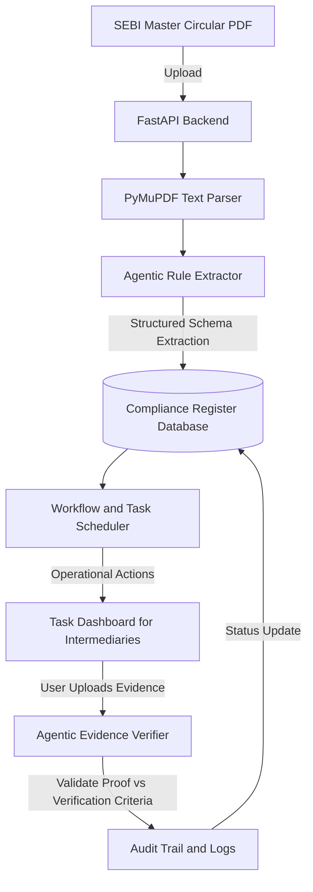

# SEBI Agentic Compliance System - Product Specification

## Overview

A standard Search and Q&A system is not sufficient to solve the compliance challenges faced by market intermediaries. A search engine helps compliance officers find text, but it does not translate that text into operational compliance actions.

This specification details a complete Agentic Compliance System. The system bridges the gap between unstructured SEBI regulatory documents and operational actions by transforming regulatory text into structured, machine-actionable compliance registers, tracking tasks, and verifying compliance evidence.

The initial implementation focuses on the SEBI Master Circular for Stockbrokers and the SEBI Master Circular for Investment Advisers.

---

## Core System Concept

The system replaces manual legal analysis with an automated, agentic pipeline.

---

## Key Modules

### 1. Dynamic Rule Extractor

Instead of just chunking text for semantic search, the system uses a parser powered by Gemini 2.5 Flash to convert unstructured regulatory paragraphs into structured records.

For every circular uploaded, the extractor identifies and stores:
- Rule Identifier (derived from circular section numbers)
- Intermediary Category (Stockbroker or Investment Adviser)
- Regulatory Obligation (clear description of what must be done)
- Due Date or Frequency (such as quarterly, annually, or within 15 days of occurrence)
- Target Department (Operations, Finance, Compliance, or IT)
- Verification Criteria (the concrete evidence required to prove compliance)

### 2. Operational Action Mapping and Task Scheduler

Once rules are stored, the system creates operational tasks.
- The system parses the frequency and due dates to generate a dynamic compliance calendar.
- Tasks are assigned to specific roles or departments within the intermediary.
- Notifications and reminders are generated automatically as deadlines approach.

### 3. Agentic Evidence Verifier

To complete the compliance loop, the intermediary must upload evidence of fulfillment.
- Users upload files like client ledger logs, internal audit reports, or bank balance statements.
- The agentic verification engine reads the uploaded evidence.
- It compares the contents of the evidence against the rule's specific verification criteria.
- It determines if the evidence matches the criteria, flags anomalies, and updates the task status to Compliant or Non-Compliant.

### 4. Immutable Audit Trail

Every translation action, task assignment, evidence upload, and verification decision is recorded. This database log provides compliance officers with a clear defense report for SEBI audits.

---

## Technical Stack

### Frontend
- React 18 with TypeScript
- Tailwind CSS
- React Query and Zustand
- Dashboard UI showing Task Calendar, Upload Portal, and Verification Status

### Backend
- FastAPI with Python 3.11
- Uvicorn async server
- PostgreSQL database to manage structured rules, tasks, and audit logs
- SQLite database option for local development
- PyMuPDF for document text parsing
- Google Gemini 2.5 Flash for both rule extraction and evidence verification

---

## Target Database Schema

### RegulatoryRule
- id (Primary Key)
- circular_name (string)
- section_reference (string)
- intermediary_type (string)
- obligation_text (text)
- frequency (string)
- verification_criteria (text)
- created_at (timestamp)

### ComplianceTask
- id (Primary Key)
- rule_id (Foreign Key pointing to RegulatoryRule)
- assignee_department (string)
- due_date (date)
- status (string, such as Pending, Under Review, Compliant, or Overdue)
- evidence_file_path (string)
- verification_feedback (text)
- completed_at (timestamp)

### AuditLog
- id (Primary Key)
- task_id (Foreign Key pointing to ComplianceTask)
- user_name (string)
- action_type (string)
- action_details (text)
- timestamp (timestamp)

---

## Concrete Regulatory Scenario Demonstration

To validate the system, the platform is pre-configured to process the SEBI Master Circular for Stockbrokers.

### The Scenario
- Rule Reference - Section 2.1 of the Stockbroker Circular (Segregation of Client Securities and Funds)
- Obligation - Stockbrokers must segregate client funds from broker funds and perform daily reconciliations.
- Verification Criteria - Daily reconciliation sheet showing zero discrepancy between client bank balance and client ledger balance.
- Agent Action - The user uploads a reconciliation spreadsheet. The agent verifies that the column values match and confirms there are no negative balances or mixing of broker funds.
