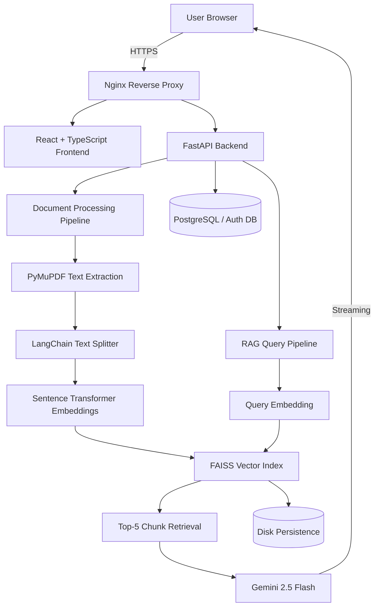

# SEBI AI Agent - Product Specification

## Overview

A full-stack, AI-powered regulatory assistant that enables financial compliance professionals to query thousands of pages of SEBI regulations, circulars, and guidelines through natural language - with every answer grounded in uploaded source documents, not AI general knowledge.

---

## Core Problem Being Solved

| Problem | Solution |
|---|---|
| SEBI regulatory corpus is massive and dense | Semantic search finds relevant sections instantly |
| Manual document review is time-consuming | Conversational Q&A reduces research time dramatically |
| General AI hallucinates legal content | RAG pipeline anchors every response to real documents |
| Answers are unverifiable | Source citations with page numbers and similarity scores |
| Compliance teams need audit trails | Full transparency on which document produced each answer |

---

## System Architecture



---

## Feature Specification

### 1. Authentication and Access Control

- JWT-based authentication (login, token refresh, logout)
- Secure session management with token expiry
- Role-based access: regular user and admin
- Protected routes on both frontend and backend
- Admin panel accessible only to admin role users

---

### 2. Document Upload and Management

**Upload Interface**
- Drag-and-drop PDF upload zone
- File type validation (PDF only)
- File size limit enforcement
- Multiple file queuing support
- Real-time dual progress bar: upload progress + indexing progress

**Accepted Document Types**
- SEBI Circulars
- SEBI Regulations
- Master Directions
- Guidelines and Frameworks
- Notifications and Amendments

**Post-Upload Processing (Background Task)**

| Stage | Tool | Detail |
|---|---|---|
| Text Extraction | PyMuPDF (fitz) | Per-page extraction, preserves page numbers |
| Chunking | LangChain RecursiveCharacterTextSplitter | 500-token chunks, 50-token overlap |
| Embedding | Sentence Transformers (all-MiniLM-L6-v2) | 384-dimensional semantic vectors |
| Indexing | FAISS | Cosine similarity index, persisted to disk |

**Document Library**
- List of all uploaded documents with metadata (name, upload date, status, page count, chunk count)
- Per-document status: Processing / Indexed / Failed
- Delete document (removes chunks from FAISS index and file from disk)
- Document preview (page count, file size, upload timestamp)

---

### 3. Chat Interface and RAG Pipeline

**User Experience**
- Conversational chat UI with message history
- Real-time token-by-token streaming of AI responses
- Markdown rendering for formatted regulatory answers
- Multi-turn context: last N conversation turns included in every prompt
- Loading indicators during retrieval and generation phases

**Query Pipeline**

```
User Question
    -> Sentence Transformer (all-MiniLM-L6-v2) -> 384-dim query vector
    -> FAISS cosine similarity search -> Top 5 matching chunks
    -> Prompt assembly (system instruction + chunks + chat history + question)
    -> Gemini 2.5 Flash (temperature=0.1, streaming enabled)
    -> Streamed markdown response + source citations
```

**Prompt Design**
- Strict system instruction: answer only from provided context
- Explicit fallback instruction: state clearly when information is not in the documents
- Retrieved chunks labeled with source filename and page number
- Conversation history included for continuity

**Source Panel**
- Collapsible panel alongside every AI response
- For each source chunk: document name, page number, similarity score, text preview
- Full traceability from answer back to source document and page

---

### 4. Admin Panel

- View all users (username, role, last login, document count)
- Promote or demote user roles
- System stats: total documents, total chunks indexed, total queries served
- FAISS index health status and last rebuild timestamp
- Ability to re-index a specific document or rebuild the full index

---

## Technical Stack

### Frontend

| Layer | Technology |
|---|---|
| Framework | React 18 with TypeScript |
| Styling | Tailwind CSS |
| State Management | React Query + Zustand |
| Routing | React Router v6 |
| HTTP Client | Axios with interceptors |
| Streaming | Fetch API with ReadableStream |
| Markdown | react-markdown with syntax highlighting |

### Backend

| Layer | Technology |
|---|---|
| Framework | FastAPI (Python 3.11+) |
| Server | Uvicorn with async workers |
| Auth | python-jose (JWT), passlib (bcrypt) |
| PDF Parsing | PyMuPDF (fitz) |
| Text Splitting | LangChain |
| Embeddings | sentence-transformers (all-MiniLM-L6-v2) |
| Vector Store | FAISS (faiss-cpu) |
| LLM | Google Gemini 2.5 Flash via google-generativeai SDK |
| Background Tasks | FastAPI BackgroundTasks |
| Database | SQLite (dev) / PostgreSQL (prod) via SQLAlchemy |

### Infrastructure

| Layer | Technology |
|---|---|
| Containerization | Docker + Docker Compose |
| Web Server / Proxy | Nginx |
| Persistence | Docker volumes (FAISS index + uploaded PDFs) |
| Launch Command | `docker-compose up` |

---

## API Endpoints

### Auth

| Method | Path | Description |
|---|---|---|
| POST | `/api/auth/register` | Register new user |
| POST | `/api/auth/login` | Login and receive JWT |
| POST | `/api/auth/refresh` | Refresh access token |
| GET | `/api/auth/me` | Get current user profile |

### Documents

| Method | Path | Description |
|---|---|---|
| POST | `/api/documents/upload` | Upload PDF and trigger indexing |
| GET | `/api/documents` | List all documents for current user |
| GET | `/api/documents/{id}/status` | Poll indexing progress |
| DELETE | `/api/documents/{id}` | Delete document and its chunks |

### Chat

| Method | Path | Description |
|---|---|---|
| POST | `/api/chat` | Submit question, receive streamed response |
| GET | `/api/chat/history` | Retrieve conversation history |
| DELETE | `/api/chat/history` | Clear conversation history |

### Admin

| Method | Path | Description |
|---|---|---|
| GET | `/api/admin/users` | List all users |
| PATCH | `/api/admin/users/{id}/role` | Update user role |
| GET | `/api/admin/stats` | System-wide statistics |
| POST | `/api/admin/reindex` | Rebuild FAISS index |

---

## Data Models

### Document

```
id, user_id, filename, original_name, file_size, page_count,
chunk_count, status (pending/processing/indexed/failed),
created_at, indexed_at, error_message
```

### Chunk (FAISS metadata store)

```
chunk_id, document_id, filename, page_number,
chunk_index, text_preview, embedding_vector
```

### ChatMessage

```
id, user_id, role (user/assistant), content,
sources (JSON array), created_at, session_id
```

### User

```
id, username, email, hashed_password, role (user/admin),
created_at, last_login, is_active
```

---

## Non-Functional Requirements

| Requirement | Target |
|---|---|
| Semantic search latency | < 200ms for top-5 retrieval |
| First token to browser | < 2 seconds from query submission |
| Concurrent users | Minimum 10 simultaneous via async Uvicorn |
| Index persistence | Survives container restart via Docker volume |
| Answer grounding | 100% of responses cite at least one source chunk |
| Hallucination guard | Explicit refusal when context is insufficient |
| PDF size support | Up to 500-page documents |

---

## Frontend Pages and Navigation

```
/login          Login page
/register       Registration page
/upload         Document upload + library
/chat           Main conversational interface
/admin          Admin panel (role-gated)
```

---

## Security Considerations

- All endpoints (except login and register) require a valid JWT
- Admin endpoints additionally require admin role check
- Uploaded files stored in server-side volume, not publicly accessible
- File type validation on both client and server
- Rate limiting on chat endpoint to prevent abuse
- CORS configured to allow only the frontend origin

---

## Deployment

```yaml
# Single command launch
docker-compose up

# Services started
- nginx        (port 80/443, reverse proxy)
- frontend     (React static build served by Nginx)
- backend      (FastAPI on Uvicorn, port 8000)

# Volumes
- faiss_index  (persists vector index across restarts)
- uploaded_pdfs (persists raw PDF files)
- db_data      (persists SQLite/PostgreSQL data)
```

---

## Open Questions / Decisions Needed

- Should document uploads be per-user (isolated indexes) or shared across all users in a single global FAISS index?
- Should conversation sessions be persistent (saved to DB) or ephemeral (in-memory per session)?
- Is Google Gemini API key managed per-user or set once at the environment/admin level?
- Should the admin panel allow global document uploads that all users can query (a shared regulatory library)?
- What is the target deployment environment (local demo, cloud VM, managed Kubernetes)?
